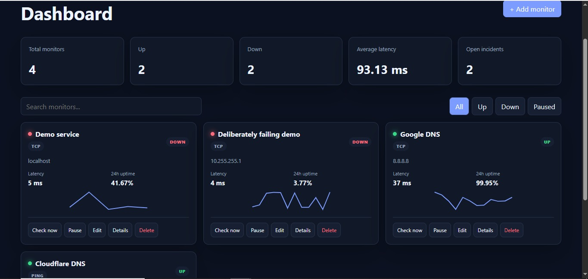
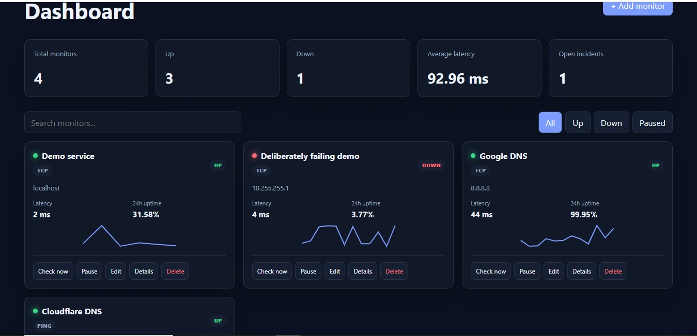
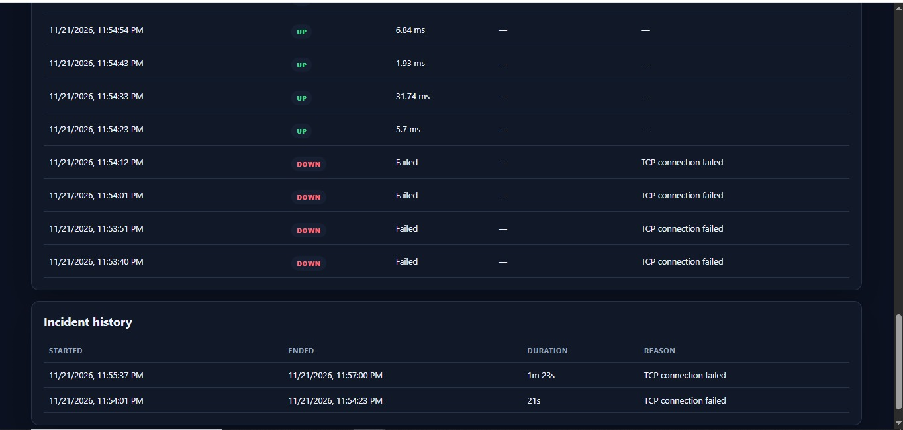

# NetWatch

[](https://github.com/victorkibetmutai/netwatch/actions/workflows/ci.yml)

NetWatch is a self-hosted network monitoring dashboard for home labs, small offices, and developers. It runs PING, TCP port, and HTTP/HTTPS checks on a schedule, tracks uptime and latency, opens an incident after repeated failures, closes it on recovery, and can send webhook alerts.

## Screenshots







## Features

- PING, TCP port, and HTTP/HTTPS monitors with configurable intervals, timeouts, failure thresholds, and expected HTTP status
- Failure threshold: a monitor goes DOWN only after several consecutive failures, so one dropped packet does not raise an alarm
- Incident tracking with start time, end time, duration, and reason
- Latency and uptime statistics that exclude failed checks, so a timeout is never counted as "latency"
- Dashboard with summary cards, search, filters, sparklines, and add, edit, pause, resume, check-now, and delete controls
- Monitor detail page with a real time-axis latency chart, failure markers, gaps where no data was collected, check history, and incident history
- Longer chart ranges (24h, 7d, 30d) are aggregated into time buckets to stay readable
- Live updates through Server-Sent Events (no page refresh)
- Friendly error messages for failed checks (for example "Request timed out" and "Destination host unreachable")
- JWT authentication with bcrypt-hashed passwords
- Optional webhook alerts for DOWN and recovery events, using a JSON body with both `content` (Discord) and `text` (Slack)
- Optional setting to require login for read access as well
- Dockerfile and docker-compose.yml, and a GitHub Actions workflow that runs the test suite

## Architecture

```text
Browser --> Express routes --> Services / checkers --> SQLite
                    |                                    |
                    +----------- SSE events -------------+
```

See [docs/architecture.md](docs/architecture.md) for the component diagram.

## Tech Stack

- Node.js 20+ and Express
- SQLite with `better-sqlite3`
- Plain HTML, CSS, and JavaScript on the front end
- Chart.js, served locally so the strict Content Security Policy can stay enabled
- Vitest and Supertest
- Docker and docker-compose
- GitHub Actions

## Run Locally

Requires Node.js 20 or newer.

```powershell
git clone https://github.com/victorkibetmutai/netwatch.git
cd netwatch
Copy-Item .env.example .env
npm install
npm run seed
npm run dev
```

Open `http://localhost:3000`, then visit `/login.html` to register the first administrator account.

`npm run seed` adds four demo monitors (a website, two public DNS servers, and one deliberately failing target so you can see the DOWN state and incidents). Running it twice does not create duplicates.

If you pull an update that adds new settings, copy the new lines from `.env.example` into your own `.env`. The app never edits your `.env` for you, and a missing line falls back to the default.

## Run with Docker

Docker Desktop must be installed and running. Set a strong `JWT_SECRET` first (see below), then:

```powershell
docker compose up --build
```

Open `http://localhost:3000`. Stop it with `docker compose down`.

## Environment Variables

| Variable | Description | Default |
|---|---|---|
| `PORT` | HTTP server port | `3000` |
| `DB_PATH` | SQLite database path | `./data/netwatch.db` |
| `JWT_SECRET` | Secret used to sign login tokens. Required in production and must be at least 32 characters | Development placeholder (with a warning) |
| `CHECK_RETENTION_DAYS` | Delete check records older than this many days | `30` |
| `WEBHOOK_URL` | Optional Discord or Slack webhook URL. Treat it like a password | Empty |
| `REQUIRE_AUTH_FOR_READ` | When `true`, every `/api` route except `/api/health` and the auth routes needs a valid login, including the live event stream | `false` |

Never commit `.env`. Generate a secure secret in PowerShell:

```powershell
node -e "console.log(require('crypto').randomBytes(32).toString('hex'))"
```

Then put it in `.env`:

```text
JWT_SECRET=<generated-secret>
```

## Status and Incident Logic

- A failed check increments `consecutive_failures`.
- The monitor becomes `down` only after reaching `failure_threshold` (default 3).
- Reaching the threshold opens exactly one incident.
- One successful check sets the monitor back to `up`, closes the open incident, and records its end time.
- Disabled monitors show `paused`. Monitors that have never been checked show `unknown`.
- A second check for the same monitor cannot start while one is running (the API answers `409 Conflict`).
- Webhook alerts are sent only when the status actually changes, never on every failed check.

## API Reference

| Method | Endpoint | Purpose |
|---|---|---|
| GET | `/api/health` | Health and process uptime |
| GET | `/api/monitors` | List monitors |
| POST | `/api/monitors` | Create a monitor (login required) |
| GET | `/api/monitors/:id` | Get one monitor |
| PUT | `/api/monitors/:id` | Update a monitor (login required) |
| DELETE | `/api/monitors/:id` | Delete a monitor (login required) |
| POST | `/api/monitors/:id/check` | Run a check now (login required) |
| GET | `/api/monitors/:id/checks?range=1h\|24h\|7d\|30d` | Check history |
| GET | `/api/monitors/:id/stats?range=1h\|24h\|7d\|30d` | Uptime and latency statistics |
| GET | `/api/incidents?monitor_id=&status=open\|closed` | Incident history |
| GET | `/api/summary` | Dashboard totals |
| GET | `/api/events` | Server-Sent Events stream |
| POST | `/api/auth/register` | Register the first administrator |
| POST | `/api/auth/login` | Obtain a login token |

Send authenticated requests with:

```text
Authorization: Bearer <token>
```

Errors use a consistent shape: `{ "error": "message" }`.

## Tests

```powershell
npm test
```

The suite covers hostname and URL validation, PING output parsing, status and incident logic, uptime and latency calculations, chart helpers, configuration checks, webhook messages, and the API (including authentication). Tests use their own temporary database and do not read your `.env`.

## Security

Monitoring tools can reach internal networks, so do not expose NetWatch to the internet without authentication and network controls.

- Hostname and URL validation rejects shell characters and non-HTTP URLs.
- PING runs through `execFile` with an argument array, never through a shell command string.
- SQL uses parameterized queries.
- JSON bodies are size-limited, Helmet security headers are on, and `/api` is rate limited.
- Passwords are hashed with bcrypt, and write endpoints require a login token.
- In production the server refuses to start without a strong `JWT_SECRET`.
- By default anyone who can reach the dashboard can view it. Set `REQUIRE_AUTH_FOR_READ=true` before using NetWatch on a shared network.
- The login token is stored in the browser's `localStorage`. Moving it to an httpOnly cookie would reduce the impact of a cross-site scripting bug.

## Limitations

- NetWatch only records outages while it is running. A laptop that sleeps leaves gaps, so use an always-on machine for 24/7 monitoring.
- Uptime is calculated from the checks that ran, not from wall-clock time.
- Timers live in memory and restart with the server.
- SQLite and a single process suit dozens of monitors, not thousands.
- Cloud hosts often block ICMP, so PING monitors may not work there.

## Design Decisions and Trade-offs

- **SQLite** keeps setup simple and fits small deployments, but it is not a distributed database.
- **Per-monitor timers** avoid a heavy job system, at the cost of living in local memory.
- **A failure threshold** reduces false alarms but delays the DOWN status by a few check intervals.
- **Server-Sent Events** instead of WebSockets, because updates only flow from server to browser and the stream reconnects automatically.
- **Failed checks are not latency.** A timeout is stored and shown as a failure, never averaged into latency.
- **Reads are open by default** for easy local use, with `REQUIRE_AUTH_FOR_READ` for locked-down setups.

## What I Learned

- On Windows, `ping` can print "Destination host unreachable" and still exit with code 0, so the parser reads the reply lines instead of trusting the exit code.
- A strict Content Security Policy blocked Chart.js from a CDN, so the library is served from the app itself.
- Overlapping checks are an expected case: they return `409 Conflict` instead of a server error.
- Honest charts need a real time axis, and the line must break across periods when no data was collected.
- Tests should never depend on a developer's personal `.env`.

## Roadmap

- DNS monitor type
- SSL certificate expiry monitor
- Public status page
- Move the login token to an httpOnly cookie

## License

[MIT](LICENSE)
